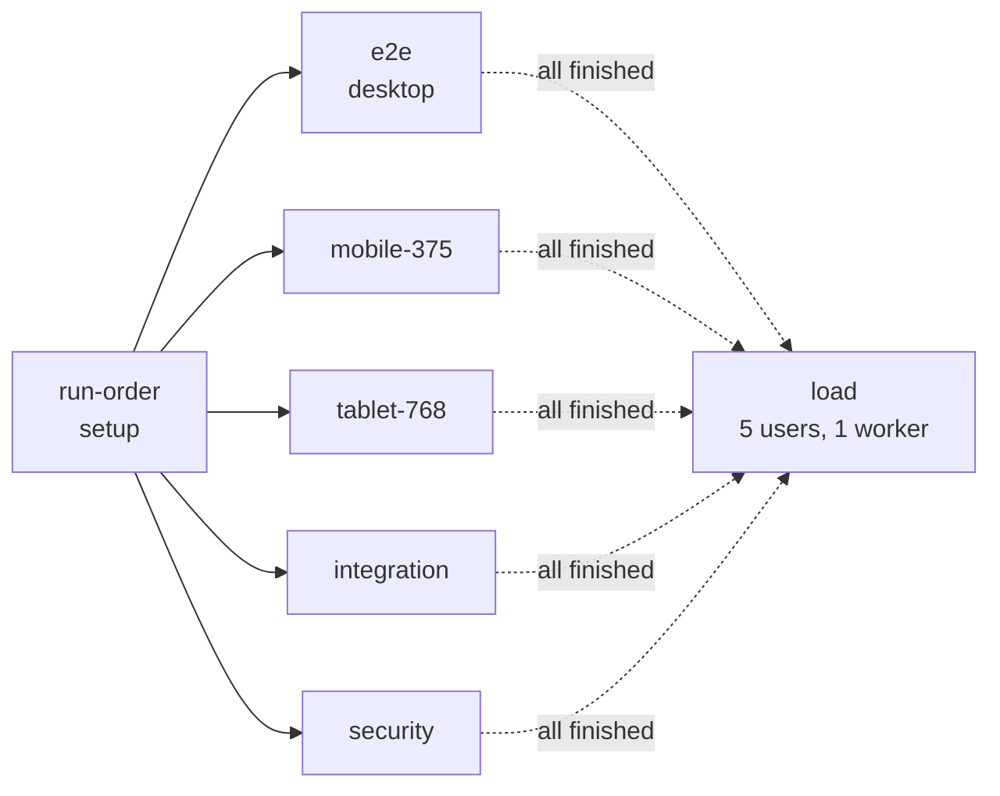

<div align="center">

# Techdome QA Assignment

**A Playwright test suite for [techdome.io](https://techdome.io): end-to-end, integration, security and load tests**


[User stories](docs/user-story-map.md) ·
[Bug report](docs/bugs.md) ·
[Load results](docs/load-test-results.md) ·
[Claude Code log](docs/claude-code-log.md) ·
[Exploration notes](docs/site-exploration.md)

</div>

---

## Contents

- [Deliverables at a glance](#deliverables-at-a-glance)
- [Quick start](#quick-start)
- [Latest results](#latest-results)
- [Bugs found](#bugs-found)
- [How the suite is organised](#how-the-suite-is-organised)
- [Project structure](#project-structure)
- [Decisions and trade-offs](#decisions-and-trade-offs)

---

## Deliverables at a glance

| Deliverable | Required | Delivered | Where |
|---|:---:|:---:|---|
| User story map | — | **30 stories, 8 personas** | [`docs/user-story-map.md`](docs/user-story-map.md) |
| E2E tests | ≥ 8 | **58** (desktop, 375 px, 768 px) | [`tests/e2e/`](tests/e2e) |
| Integration tests | ≥ 3 | **18** | [`tests/integration/`](tests/integration) |
| Security tests | ≥ 3 | **28** | [`tests/security/`](tests/security) |
| Load test | 5 users | **exactly 5 concurrent users** | [`tests/load/`](tests/load) · [`results`](docs/load-test-results.md) |
| Bug report | — | **9 bugs** with steps and evidence | [`docs/bugs.md`](docs/bugs.md) · [`evidence/`](docs/evidence) |
| Claude Code log | ≥ 5 entries | **10 entries** | [`docs/claude-code-log.md`](docs/claude-code-log.md) |
| `npx playwright test` from a fresh clone | ✅ | ✅ verified | [Quick start](#quick-start) |

Every test title starts with its story ID, for example `US-005: …`. Stories, tests and bugs can be traced in both directions, and `npx playwright test -g US-005` runs a single story.

---

## Quick start

**Requires Node.js 18 or later.**

```bash
git clone <this-repo> && cd <this-repo>
npm ci                              # or: npm install
npx playwright install chromium
npx playwright test                 # full suite; the load test runs last, on its own
```

### More commands

| Command | What it runs |
|---|---|
| `npx playwright test` | Everything (about 3 minutes) |
| `npm run test:e2e` | E2E on desktop, 375 px and 768 px |
| `npm run test:integration` | API payloads, endpoints, third parties and consent |
| `npm run test:security` | Headers, XSS, data exposure and hardening |
| `npm run test:load` | Load test: exactly 5 concurrent users, never more |
| `npm run report` | Opens the HTML report, whose annotations show bug IDs, LCP and third-party hosts |
| `npx playwright test -g US-010` | One user story |

> **Expected result:** all green, with **6 tests reported as "expected to fail"**. Each of those reproduces a confirmed bug (see [Bugs found](#bugs-found)). The load test rewrites `docs/load-test-results.md` on every run.

---

## Latest results

Run from a fresh clone (`git clone` → `npm ci` → `npx playwright test`):

| Result | Count |
|---|---:|
| ✅ Passed | **102**, including the 6 expected-fail tests for known bugs |
| ⏭️ Skipped | **4**, by design: phone-only stories skip at 768 px, and tablet-only stories skip at 375 px |
| ❌ Failed | **0** |

**Load test (5 concurrent users):**

| Criterion | Target | Measured | Result |
|---|---|---|:---:|
| Peak concurrent users | exactly 5 | 5 | ✅ |
| p95 document response | < 3000 ms | 778–847 ms across runs | ✅ |
| HTTP 5xx responses | 0 | 0 | ✅ |

Full breakdown: [`docs/load-test-results.md`](docs/load-test-results.md).

---

## Bugs found

**9 bugs: 4 Medium and 5 Low.** Each one has steps to reproduce and evidence in [`docs/bugs.md`](docs/bugs.md).

| ID | Severity | Bug | Caught by |
|---|:---:|---|---|
| [BUG-001](docs/bugs.md#bug-001) | 🟠 Medium | No Content-Security-Policy on any page | `security/headers.spec.js` · `test.fail()` |
| [BUG-002](docs/bugs.md#bug-002) | 🟠 Medium | Intermittent responses of up to about 20 s, and one dropped connection | measurements and load report |
| [BUG-003](docs/bugs.md#bug-003) | 🟠 Medium | Clicking Subscribe before JavaScript loads silently discards the email | `e2e/newsletter.spec.js` · `test.fail()` |
| [BUG-004](docs/bugs.md#bug-004) | 🟠 Medium | 404 page has no navigation or way back | `e2e/navigation.spec.js` · `test.fail()` |
| [BUG-005](docs/bugs.md#bug-005) | 🟡 Low | Analytics and session cookies set without `Secure` | `security/hardening.spec.js` · `test.fail()` |
| [BUG-006](docs/bugs.md#bug-006) | 🟡 Low | Form errors are not linked to their inputs for screen readers | `e2e/accessibility.spec.js` · `test.fail()` |
| [BUG-007](docs/bugs.md#bug-007) | 🟡 Low | `/gcc` heading text has no spaces | `e2e/accessibility.spec.js` · `test.fail()` |
| [BUG-008](docs/bugs.md#bug-008) | 🟡 Low | Cookie policy doesn't name the LeadConnector tracker | `integration/third-party.spec.js` |
| [BUG-009](docs/bugs.md#bug-009) | 🟡 Low | No `security.txt` file | manual check |

Known bugs are marked with `test.fail()` and a `bug` annotation, so they are **not skipped**. The suite stays green while the bug exists, and the test turns **red when Techdome fixes it**, which is the signal to remove the marker.

---

## How the suite is organised



The `load` project is the **teardown** of `run-order`. In a full run it starts only after every other suite has finished, so its 5 users never overlap other test traffic.

---

## Project structure

```
tests/
  run-order.setup.js       no-op setup project; makes `load` its teardown so it runs last
  e2e/                     homepage, navigation, contact-form, newsletter, ctas, footer,
                           accessibility, responsive.mobile (run at 375 px and 768 px)
  integration/             form-network (API payloads), endpoints, third-party and consent
  security/                headers, xss-injection, data-exposure, hardening
  load/                    homepage-contact.load (5 users)
utils/
  fixtures.js              test/expect, page objects, request and console capture,
                           write-mocking, consent and popup pre-seeding
  pages/                   BasePage, Header, Footer, HomePage, ContactPage
  helpers.js               link audit, status, overflow, LCP, percentiles, secret scanner, doc writer
  test-data.js             expected site facts, inputs, XSS payloads, MAX_CONCURRENT_USERS = 5
docs/
  user-story-map.md        30 stories with acceptance criteria and traceability
  bugs.md                  9 bugs with steps, impact and evidence
  load-test-results.md     generated by the load test on every run
  claude-code-log.md       how Claude Code was used, prompt by prompt
  site-exploration.md      raw exploration notes and findings
  evidence/                screenshots, header dumps, timings and cookie dumps cited in bugs.md
```

---

## Decisions and trade-offs

| Decision | Why |
|---|---|
| **5-user load limit, enforced three ways** | (1) The spec refuses to start if `USERS > MAX_CONCURRENT_USERS`. (2) `load` is a teardown project, so it never overlaps other traffic. (3) A live in-flight counter records the peak, always 5, in the report. |
| **Known bugs use `test.fail()`, not `skip`** | The suite stays reliable for regression runs, the report lists every bug, and each test turns red once the bug is fixed. |
| **No real data is ever created** | A fixture intercepts every non-GET request and answers it locally, so no test files a lead, subscription or booking on production. Tests assert on the exact payload the browser *would* send, and on how the UI reacts to success, failure and network errors. |
| **XSS tests stop at the browser** | Payloads go through real forms and URL parameters, and the tests prove they never execute or render as HTML. Attack strings are deliberately not sent to the production backend, so server-side sanitisation is out of scope. |
| **Gentle on a fragile live site** | Response spikes of 20 s and a dropped connection were measured, so the suite uses 2 workers, 60 s navigation timeouts and 1 retry. Link audits use the API request context, 2 requests at a time. |
| **Hydration-aware page objects** | The site is built with Next.js. Clicks before React hydrates are ignored, or submit forms natively, which is how BUG-003 was found. Page objects wait for hydration instead of sleeping. |
| **Role and label selectors** | Inputs have labels but no `name` or `data-testid`, and Tailwind classes are unstable, so selectors use `getByRole` and `getByLabel` throughout. |
| **Bot-blocked external links** | LinkedIn, X, Upwork and Clutch return 403 to automation, so those links are checked by `href` and `target` rather than HTTP status. |
| **JavaScript, not TypeScript** | The brief shows `playwright.config.ts`, but this project was scaffolded in JavaScript, with `// @ts-check` for editor checking. The behaviour is identical. |
| **Chromium only, plus 375 px and 768 px viewports** | Adding Firefox and WebKit would triple the run time against a live site without adding coverage the brief asks for. They can be added as projects. |
| **Evidence on failure** | Screenshots, video and traces are kept for failing tests in `test-results/`. Console messages and intercepted requests are attached to every test that has them. |

---

<div align="center">

Built with Playwright 1.65 on Node.js 22 · AI-assisted with Claude Code (see the [usage log](docs/claude-code-log.md))

</div>
