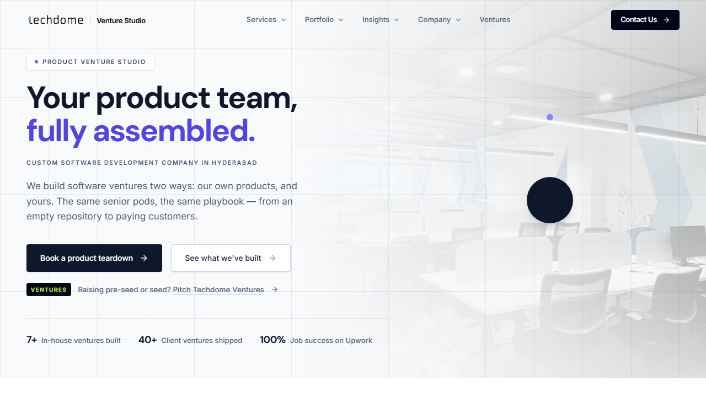
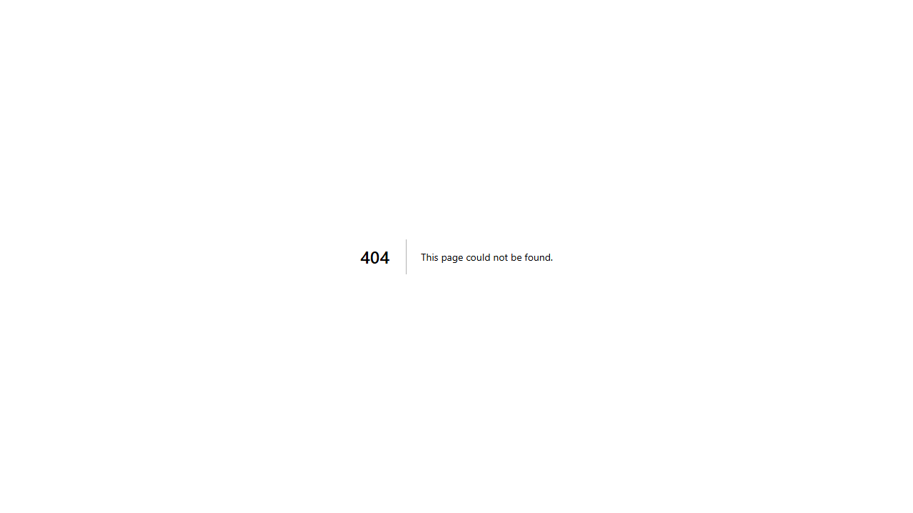
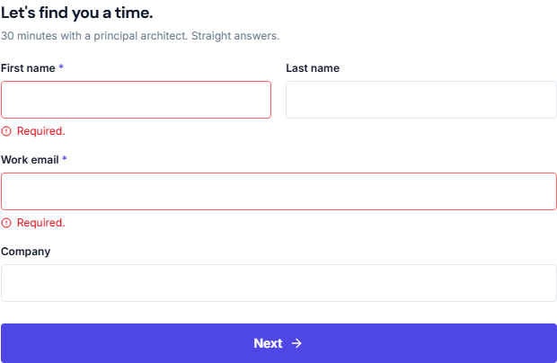

# 🐞 Bug Report: techdome.io

Found by the Playwright suite in this repo plus targeted investigation, 2026-11-10.
Every bug below was **re-verified** at the end of the session, and its evidence is in [`docs/evidence/`](./evidence/).
Bugs reproduced by the suite have a test marked `test.fail()` with a `bug` annotation. The test stays green while the bug exists and turns red when it is fixed.

| ID | Severity | Area | Summary | Test |
|---|---|---|---|---|
| [BUG-001](#bug-001) | 🟠 Medium | Security | No Content-Security-Policy on any page | `security/headers.spec.js` |
| [BUG-002](#bug-002) | 🟠 Medium | Performance | Intermittent multi-second (up to 20 s) responses and a dropped connection | `load/…load.spec.js` (records), evidence |
| [BUG-003](#bug-003) | 🟠 Medium | Forms | Newsletter signup before JS loads silently discards the email | `e2e/newsletter.spec.js` |
| [BUG-004](#bug-004) | 🟠 Medium | UX / Navigation | 404 page has no navigation, branding or way back | `e2e/navigation.spec.js` |
| [BUG-005](#bug-005) | 🟡 Low | Security | Analytics + LeadConnector session cookies set without `Secure` | `security/hardening.spec.js` |
| [BUG-006](#bug-006) | 🟡 Low | Accessibility | Booking-form errors not linked to their inputs | `e2e/accessibility.spec.js` |
| [BUG-007](#bug-007) | 🟡 Low | SEO / Content | `/gcc` H1 text has no spaces ("YourengineeringcentreinIndia…") | `e2e/accessibility.spec.js` |
| [BUG-008](#bug-008) | 🟡 Low | Privacy | Cookie policy doesn't name the LeadConnector/GoHighLevel tracker | `integration/third-party.spec.js` (soft-accepted) |
| [BUG-009](#bug-009) | 🟡 Low | Security | No `/.well-known/security.txt` | manual |

Severity follows the brief: **Critical** (site unusable) · **High** (key feature broken) · **Medium** (functional but noticeable issue) · **Low** (polish).

---

## BUG-001

**Severity:** 🟠 Medium\
**Summary:** No Content-Security-Policy is sent on any page, as a header or a `<meta>` tag.\
**Steps:**
1. Run `curl -sI https://techdome.io/` (also `/contact`, `/pricing`, `/products/sparrow`, a case study)
2. Look for `Content-Security-Policy` / `Content-Security-Policy-Report-Only`
3. View source and search for `http-equiv="Content-Security-Policy"`

**Expected:** A CSP restricting script/style/frame sources. The brief lists it alongside HSTS and X-Frame-Options, which *are* present.\
**Actual:** No CSP header or meta tag on any audited page. Other headers are good: HSTS 2 years + preload, XFO `SAMEORIGIN`, nosniff, Referrer-Policy, Permissions-Policy.\
**Impact:** CSP is the main defence-in-depth layer if any XSS slips through. Missing it matters more here because the site loads ~19 third-party hosts after consent (BUG-005, BUG-008). Not Critical: no exploitable XSS was found (US-025 tests pass).\
**Evidence:** [`evidence/headers-home.txt`](./evidence/headers-home.txt) (CSP header count `0`, meta count `0`); test `US-024: Content-Security-Policy is present on every page` (expected-fail).

---

## BUG-002

**Severity:** 🟠 Medium\
**Summary:** Page responses are intermittently very slow (TTFB up to ~20 s) and one request failed to connect, while control sites from the same network answered in < 1 s.\
**Steps:**
1. Request `https://techdome.io/contact` repeatedly with curl (`-w "%{time_starttransfer} %{time_total}"`)
2. Fire 3 requests to `/` in parallel
3. Compare with `https://playwright.dev/` / `https://github.com/` from the same machine

**Expected:** Consistent sub-second to ~1 s document responses (pages are pre-rendered: `x-nextjs-prerender: 1`).\
**Actual (session measurements):**

| When | Observation |
|---|---|
| Exploration (13:5x UTC) | `/contact` TTFB **19.6 s** and **20.3 s** on 2 of 5 sequential requests |
| Exploration | 3 parallel requests to `/`: total **10.8 s, 44.5 s, 54.2 s** |
| Exploration | `/robots.txt`: **connection failed** (curl `000`) |
| Exploration | Playwright `page.goto('/')` hit the 30 s `load` timeout |
| Re-check (16:03 UTC) | 12 sequential: mostly 0.5–0.9 s, spikes of **2.5 s** and **5.0 s** total |
| Load test (5 users) | p95 1026 ms: passed at that moment |
| Control | playwright.dev 0.39 s, github.com 0.25 s TTFB |

**Likely cause (hypothesis):** `cf-cache-status: DYNAMIC` means Cloudflare is not caching the HTML even though Next.js reports `x-nextjs-cache: HIT`, so every request goes to the Railway origin (edges seen: `sin1`, `hkg1`, `lax1`). Origin cold starts or regional routing would explain the spikes.\
**Impact:** A prospect hitting a 20 s spike will likely bounce. It also made test runs flaky until timeouts were raised. Medium rather than High because it's intermittent and the site recovers.\
**Evidence:** [`evidence/response-times.txt`](./evidence/response-times.txt), [`site-exploration.md` §10](./site-exploration.md), [`load-test-results.md`](./load-test-results.md).

---

## BUG-003

**Severity:** 🟠 Medium\
**Summary:** Clicking **Subscribe** before the page's JavaScript has loaded reloads the page as `/?website=` and silently discards the email address.\
**Steps:**
1. Open `https://techdome.io/` with JavaScript disabled (or click quickly on a slow connection, before hydration)
2. Type an email into the footer field "Enter your work email"
3. Click **Subscribe**

**Expected:** Either the email is submitted (progressive enhancement: give the input a `name` and the form an `action`), or the button stays disabled / says it's loading until the form is ready.\
**Actual:** The `<form method="get">` submits natively. The email `<input>` has no `name` attribute, so only the honeypot is sent: the browser navigates to `https://techdome.io/?website=`, the email is gone, no subscription request is made, and no message is shown. The visitor believes they subscribed.\
**Impact:** Lost leads with no signal to the user. More likely on slow mobile networks or during the slow spells in BUG-002. Same root pattern: the booking widget isn't a `<form>`, and its inputs have no `name`.\
**Evidence:** [`evidence/bug-newsletter-nojs.png`](./evidence/bug-newsletter-nojs.png); test `US-010: subscribing before the page is interactive does not silently lose the email` (expected-fail). Found while debugging early flaky clicks in the framework (see `site-exploration.md` §10).

---

## BUG-004

**Severity:** 🟠 Medium\
**Summary:** The 404 page is the bare Next.js default: no header, logo, navigation, search or link back to the site.\
**Steps:**
1. Go to `https://techdome.io/this-page-does-not-exist-qa` (or any mistyped/outdated URL)
2. Observe the page

**Expected:** A branded 404 with the site header/footer and links to Home, Work, Contact.\
**Actual:** Plain white page "404 | This page could not be found." with **0 links**. The status code is correctly 404.\
**Impact:** Anyone following an old or mistyped link (e.g. from a shared case study) is stranded and must edit the URL by hand. A navigation dead end, which is why it's Medium rather than cosmetic.\
**Evidence:** [`evidence/bug-404-page.png`](./evidence/bug-404-page.png), [`evidence/browser-evidence.json`](./evidence/browser-evidence.json) (`notFound.links: 0`); test `US-004: 404 page lets the visitor get back to the site` (expected-fail).

---

## BUG-005

**Severity:** 🟡 Low\
**Summary:** After "Accept all", cookies are set on `.techdome.io` without the `Secure` flag, including a LeadConnector *session token* cookie.\
**Steps:**
1. Open `https://techdome.io/` in a fresh browser profile
2. Click **Accept all** in the "Cookie preferences" dialog, wait ~5 s
3. DevTools → Application → Cookies → `https://techdome.io`

**Expected:** All cookies on an HTTPS-only (HSTS) site carry `Secure`.\
**Actual:** `_ga`, `_ga_D3NY626SEL`, `_gcl_au`, `_fbp`, `_clck`, `_clsk` and **`lc_session_tk_44cb…`** have `Secure=false`. The `lc_session_tk` cookie is also not `HttpOnly`. OpenAI's cookies (`__oaiq_consent`, `__obref`) are correctly `Secure`.\
**Impact:** Low: HSTS with preload means browsers rarely send plain-HTTP requests, and most of these are analytics IDs. The session-token cookie is the most sensitive. Fix: gtag `cookie_flags: 'secure;samesite=lax'`, and the equivalent options for Meta/Clarity/LeadConnector.\
**Evidence:** [`evidence/browser-evidence.json`](./evidence/browser-evidence.json) (`cookies`); test `US-028: cookies set on techdome.io after consent carry the Secure flag` (expected-fail).

---

## BUG-006

**Severity:** 🟡 Low\
**Summary:** Booking-form validation errors are shown visually but not announced to screen-reader users as belonging to their fields.\
**Steps:**
1. Go to `https://techdome.io/contact`
2. Click **Next** without filling anything in
3. Inspect `#lead-field-firstName`

**Expected:** `aria-describedby` (or `aria-errormessage`) on the input pointing at the "Required." message, so it's read when the field is focused.\
**Actual:** `aria-invalid="true"` is set (good), but `aria-describedby` and `aria-errormessage` are `null`. The inputs also have no `name` attribute, which hurts browser autofill.\
**Evidence:** [`evidence/bug-booking-errors.png`](./evidence/bug-booking-errors.png), [`evidence/browser-evidence.json`](./evidence/browser-evidence.json) (`bookingErrors`); test `US-030: booking-form error messages are linked to their inputs` (expected-fail).

---

## BUG-007

**Severity:** 🟡 Low\
**Summary:** The `/gcc` H1 renders as separate words visually, but its text is one glued string: "YourengineeringcentreinIndia.Werunitfromdayone,andhanditoverwhenyou’reready."\
**Steps:**
1. Go to `https://techdome.io/gcc`
2. Select and copy the main heading, paste it into a text editor (or run `document.querySelector('h1').textContent` in the console)

**Expected:** "Your engineering centre in India. We run it from day one, and hand it over when you’re ready."\
**Actual:** Each word is an `inline-block` `` spaced only by CSS `margin-right`, with no whitespace between spans, so `textContent`/`innerText` and copy-paste have no spaces. Other pages' animated headings use `&nbsp;` inside each span and are fine.\
**Impact:** Copy-paste, find-in-page and crawlers/link previews that read raw text get a glued string for the page's most important heading. **Correction made during testing:** Chromium's accessibility tree *does* insert spaces, so screen readers are **not** affected (an earlier note in `site-exploration.md` claimed they were).\
**Evidence:** [`evidence/bug-gcc-h1.png`](./evidence/bug-gcc-h1.png) (looks fine visually), [`evidence/browser-evidence.json`](./evidence/browser-evidence.json) (`gcc.textContent`, `gcc.html`); test `US-030: /gcc H1 text has real spaces…` (expected-fail).

---

## BUG-008

**Severity:** 🟡 Low\
**Summary:** After consent, LeadConnector/GoHighLevel tracking loads (`backend.leadconnectorhq.com`, `link.msgsndr.com`, cookie `lc_session_tk_*`), but the cookie policy only calls it "our customer-records service" and never names the vendor.\
**Steps:**
1. Accept all cookies on `https://techdome.io/` and watch the Network panel
2. Read `https://techdome.io/cookie-policy`

**Expected:** Every third-party processor named, as the policy does for Google, Meta, Microsoft Clarity and OpenAI.\
**Actual:** LeadConnector is unnamed. The policy also lists LinkedIn cookies (`bcookie`, `lidc`) although no LinkedIn tag loaded.\
**Impact:** Privacy transparency (GDPR Art. 13 expects recipients to be identifiable). No functional impact.\
**Evidence:** `third-party-after-consent.json` attached by `US-022: "Accept all"…` in the HTML report; [`site-exploration.md` §12](./site-exploration.md).

---

## BUG-009

**Severity:** 🟡 Low\
**Summary:** `https://techdome.io/.well-known/security.txt` returns 404, although the site has a `/security` page aimed at enterprise buyers.\
**Steps:** 1. Open `https://techdome.io/.well-known/security.txt`. 2. Observe 404.\
**Expected:** An RFC 9116 `security.txt` with a contact for vulnerability reports.\
**Actual:** 404.\
**Evidence:** `site-exploration.md` §6.

---

## Observations (not filed as bugs)

| Observation | Why it's not a bug |
|---|---|
| "Work email \*" accepts `@gmail.com` | Product decision. Flagged as a question in US-006 (test records it as an annotation) |
| `rahul.joshi@techdome.net.in` in every page's source | Intentional public contact; allowlisted in the data-exposure scan |
| Payloads like `` are sent raw in the `/api/leads` JSON | Normal for JSON APIs. The browser never executes them (US-025 passes). Server-side handling not tested, to avoid sending attack strings to production |
| Desktop header CTA is "Contact Us" but "Book call" on mobile | Deliberate responsive copy, not inconsistent behaviour |

## Investigated and ruled out
These are kept here so the reasoning is visible:
- **Preload warnings** ("CSS/fonts preloaded but not used within a few seconds") were seen once on `/contact` during exploration but **did not reproduce** on re-check (0 console messages), so they're not filed.
- **Homepage H2s "empty"**: the probe read `innerText` of sections using `content-visibility:auto`. The accessible names are correct.
- **Mega-menu `aria-expanded` stuck on `false`**: the probe read the state after a click, which closes the hover menu. It's `true` while open, and a passing test now covers it.
- **12 console "page errors" on the homepage**: caused by our own init script touching `localStorage` on `about:blank`. Fixed in `utils/fixtures.js`.
- **External links returning 403** (LinkedIn, X, Upwork, Clutch, Product Hunt): bot-blocking, not broken links. The tests check their `href` instead.
